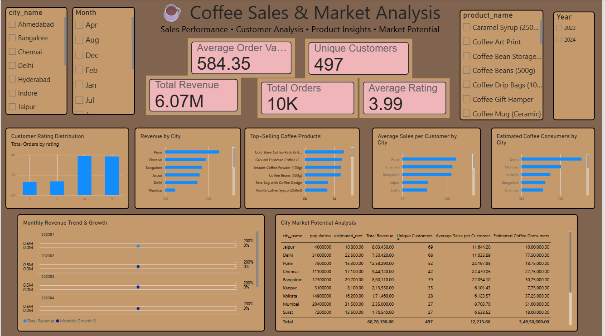

# ☕ Coffee Sales & Market Analysis

A data analytics and business intelligence project exploring coffee sales performance, customer behavior, product demand, and city-level market opportunities using **SQL, PostgreSQL, and Microsoft Power BI**.

The project transforms sales data into actionable business insights through SQL analysis and an interactive Power BI dashboard.

## 📊 Dashboard Preview



## 🎯 Project Objectives

- Analyze overall coffee sales, revenue, and order performance.
- Understand customer purchasing behavior and ratings.
- Identify top-selling coffee products.
- Compare revenue and sales performance across cities.
- Explore city-level coffee consumption estimates and market potential.
- Build an interactive dashboard to support data-driven business decisions.

## 🛠️ Tech Stack

| Technology | Purpose |
|---|---|
| PostgreSQL | Relational database and SQL analysis |
| SQL | Data querying, aggregations, and business analysis |
| Microsoft Power BI | Interactive dashboard and data visualization |
| DAX | Measures and KPI calculations, where applicable |
| Data Visualization | Sales, customer, product, and market insights |

## 📈 Key Performance Indicators

The dashboard summarizes the following metrics from the current report:

| KPI | Displayed Value |
|---|---:|
| Total Revenue | 6.07M |
| Total Orders | 10K |
| Unique Customers | 497 |
| Average Order Value | 584.35 |
| Average Customer Rating | 3.99 |

*These values reflect the dashboard screenshot and may change if the underlying data or report filters change.*

## 🔍 Dashboard Features

### 1. Sales Performance Analysis
- Total revenue and order tracking.
- Average order value analysis.
- Monthly revenue and growth visualization.
- Interactive filtering by year and month.

### 2. Customer Analysis
- Unique customer tracking.
- Customer rating distribution.
- Average sales per customer across cities.
- City-level comparisons of customer activity.

### 3. Product Performance
- Top-selling coffee products by order volume.
- Product-level comparisons to identify popular items.
- Product filtering for more focused analysis.

### 4. Geographic & Market Analysis
- Revenue comparison across cities.
- Estimated coffee consumers by city.
- City-level market potential analysis.
- Comparison of population, estimated rent, revenue, customer counts, and average sales per customer.

### 5. Interactive Filtering
The dashboard includes slicers for:
- City
- Month
- Product
- Year

These filters allow users to explore different segments of the business and investigate performance patterns.

## 💡 Business Questions Explored

This project uses data analysis to investigate questions such as:

1. How much revenue does the business generate?
2. Which coffee products have the highest order volumes?
3. Which cities contribute the most revenue?
4. How do customer ratings vary?
5. Which cities have higher average sales per customer?
6. How does estimated coffee consumption differ between cities?
7. Which cities may offer attractive opportunities for market expansion?
8. How does revenue change over time?

## 🗃️ Database & SQL Analysis

PostgreSQL is used to query and analyze the project's relational sales data.

The project works with business entities such as cities, products, customers, and sales.

The analysis focuses on:
- Aggregating sales and revenue.
- Joining related tables to combine business information.
- Grouping results by city, product, and time period.
- Calculating customer and sales metrics.
- Comparing geographic markets using available population and consumption estimates.

SQL enables the analysis to be performed at the data level before presenting the results in Power BI.

## 📂 Repository Structure

The project is organized around SQL analysis, source data, and the Power BI dashboard.

```text
Coffee-Sales-Market-Analysis/
│
├── images/
│   └── coffee-sales-dashboard.png
│
├── data/                 # Source data, if included
├── sql/                  # SQL scripts, if organized separately
├── powerbi/              # Power BI report, if included
└── README.md
```

*Adjust this structure to match the actual files and folders in the repository.*

## 🚀 How to Explore the Project

1. Clone or download this repository.
2. Review the available SQL scripts and source data.
3. Set up PostgreSQL and import the required data if you want to run the queries.
4. Execute the SQL analysis against your database.
5. Open the Power BI report file, if included, using Microsoft Power BI Desktop.
6. Use the dashboard filters to explore sales, customers, products, and market performance.

**Requirements:** PostgreSQL for database analysis and Microsoft Power BI Desktop for viewing or modifying the report. Exact setup steps depend on the files included in the repository.

## 📚 Skills Demonstrated

- SQL querying and relational data analysis
- PostgreSQL database workflows
- Data aggregation and business metric calculation
- Customer and product performance analysis
- Exploratory business data analysis
- Power BI dashboard development
- Data visualization and KPI reporting
- Business-oriented interpretation of data
